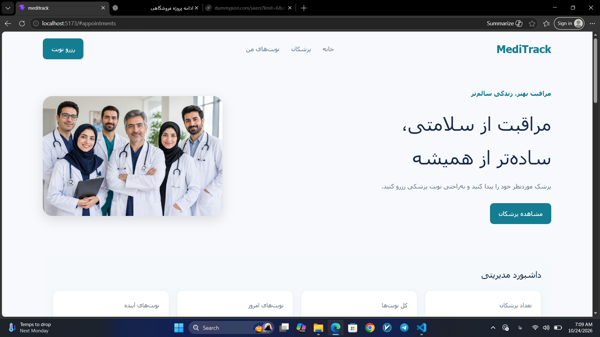

# MediTrack 🩺

A responsive doctor appointment booking application built with React and Vite.

## Preview



## Features

- Browse doctors and their specialties
- Search doctors by name
- Filter doctors by specialty
- Book and cancel appointments
- Prevent duplicate appointments
- Save appointments in localStorage
- Responsive layout for different screen sizes

## Tech Stack

- React
- Vite
- JavaScript
- CSS
- localStorage

## Getting Started

Clone the repository:

```bash
git clone https://github.com/fshoja/meditrack.git
```

Install dependencies:

```bash
npm install
```

Start the development server:

```bash
npm run dev
```

## Build

```bash
npm run build
```

## Author

Farzaneh Shoja

GitHub: https://github.com/fshoja
